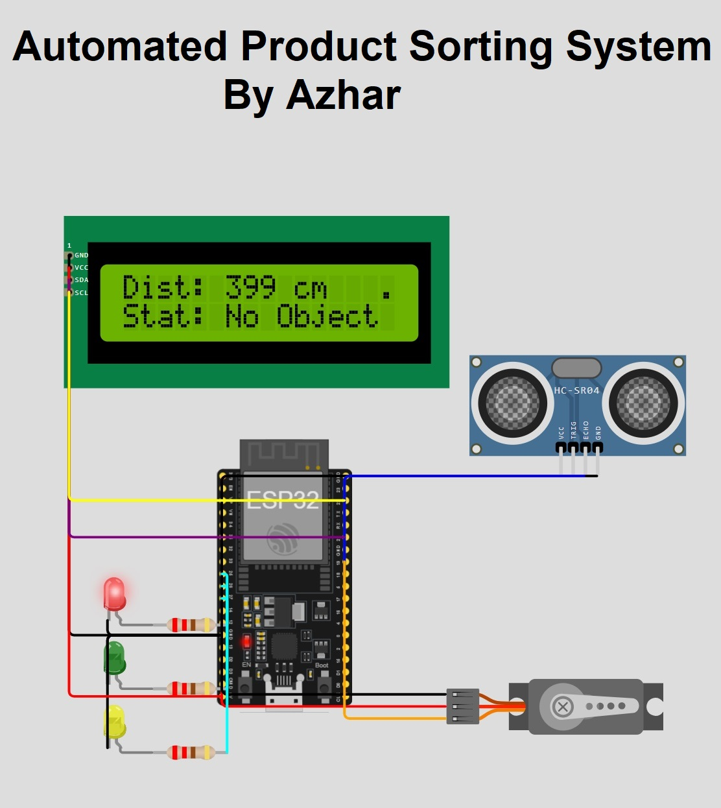

# Automated Product Sorting System (ESP32 / FreeRTOS) 🏭

## 📖 Overview

This project is an industrial-grade automated product sorting simulation engineered using the **ESP32** microcontroller and **FreeRTOS**. It evaluates incoming packages via an ultrasonic sensor and physically routes them to designated bins using a PWM servo motor, while outputting live telemetry to a 16x2 I2C LCD. The firmware leverages dual-core processing and thread-safe queues, demonstrating deterministic, concurrent hardware management critical for factory automation and PLC replacement roles.

## 🎯 Projects For...

- **Embedded Systems Candidates:** An advanced portfolio piece proving competency with Real-Time Operating Systems (FreeRTOS), multi-threading, and inter-process communication (IPC) in C++.
- **Industrial IoT Engineers:** A practical demonstration of non-blocking hardware logic and automated physical routing used in modern warehouse conveyor systems.
- **Computer Science Students:** A hands-on bridge from sequential, single-loop programming to asynchronous, multi-core architecture.

## 🛠️ Tech Stack & Components

- **Microcontroller:** ESP32 (30-pin DevKitC v4)
- **Firmware Language:** C++ (Arduino Core with native FreeRTOS)
- **Simulation Environment:** Wokwi Simulator
- **Required Libraries:**
  * `ESP32Servo` (For hardware timer-based PWM control)
  * `LiquidCrystal_I2C.h` (For display rendering)
  * `Wire.h` (Native I2C communication)
- **Hardware Components:**
  * 1x 16x2 I2C Character LCD
  * 1x HC-SR04 Ultrasonic Sensor
  * 1x Standard Servo Motor
  * 3x LEDs (Red, Green, Yellow)
  * 3x 220Ω Resistors

## ✨ Features

- **Dual-Core Processing:** Eliminates processing bottlenecks by explicitly pinning sensor data acquisition to Core 0 and hardware actuation/UI rendering to Core 1.
- **Thread-Safe Queues:** Safely passes memory and variables between distinct FreeRTOS tasks without race conditions using `xQueueSend` and `xQueueReceive`.
- **Dynamic Hardware Routing:** Evaluates physical distance thresholds in real-time to sort packages into Bin A (Small), Bin B (Large), or Idle state.
- **Synchronized Telemetry:** Maintains a live-updating I2C LCD and Serial CLI logging system that operates entirely asynchronously from the sensor polling rate.

## 🔌 Hardware Configuration (Pinout)

### I2C LCD 1602 Wiring

| LCD Pin | ESP32 Pin | Description | 
| ----- | ----- | ----- | 
| GND | GND | Ground | 
| VCC | 5V / VIN | Power (5V) | 
| SDA | Pin 21 | I2C Serial Data | 
| SCL | Pin 22 | I2C Serial Clock | 

### Sensor & Actuator Wiring

| Component | Pin Function | ESP32 Pin | Type | 
| ----- | ----- | ----- | ----- |
| HC-SR04 | TRIG | Pin 5 | Output |
| HC-SR04 | ECHO | Pin 18 | Input |
| Servo | PWM / Signal | Pin 19 | Output (PWM) |
| Red LED | Anode (+) | Pin 27 | Output (Idle) |
| Green LED | Anode (+) | Pin 25 | Output (Bin A) |
| Yellow LED | Anode (+) | Pin 26 | Output (Bin B) |

*(Note: All LED cathodes connect to GND via 220Ω resistors. The HC-SR04 and Servo VCC connect to 5V).*

## 🚀 End-to-End Setup Guide

### Option A: Running in Wokwi Simulator (Web-based)

1. Go to [Wokwi](https://wokwi.com/) and create a new **ESP32** project.
2. In the `diagram.json` tab, paste the project's JSON configuration.
3. Open the **Library Manager** (the book icon) and add `ESP32Servo` and `LiquidCrystal I2C`.
4. In the `sketch.ino` tab, paste the C++ FreeRTOS firmware code.
5. Click the **▶ Play** button. Click on the HC-SR04 sensor and drag the slider to change the distance and trigger the sorting logic.

### Option B: Deploying to Physical Hardware

1. **Install Arduino IDE:** Download and install the latest Arduino IDE.
2. **Install ESP32 Core:**
   * Go to `Tools > Board > Boards Manager`.
   * Search for **esp32** (by Espressif Systems) and install it.
3. **Install Libraries:**
   * Go to `Sketch > Include Library > Manage Libraries`.
   * Search for and install **ESP32Servo** (by Kevin Harrington) and **LiquidCrystal I2C** (by Frank de Brabander).
4. **Wire the Circuit:** Connect the physical components exactly as detailed in the Hardware Configuration tables above. Use an external 5V power supply for the servo if it draws too much current from the ESP32 directly.
5. **Upload the Code:**
   * Select your ESP32 Dev Module and the correct COM port from the `Tools` menu.
   * Click **Upload**.

## 🧠 Code Explanation

The firmware discards the standard Arduino `loop()` and instead utilizes FreeRTOS to manage autonomous tasks:

1. **Hardware & Queue Initialization (`setup`):**
   The system initializes the GPIOs, attaches the PWM servo, and boots the I2C LCD. Crucially, it uses `xQueueCreate` to allocate a thread-safe memory queue capable of holding 5 integer values. It then uses `xTaskCreatePinnedToCore` to spawn two infinite tasks, assigning them to separate CPU cores to ensure true concurrency.
2. **Sensor Polling Task (Core 0):**
   `readSensorTask` runs continuously in the background. It generates the necessary HIGH/LOW trigger pulses for the HC-SR04 and calculates the distance via the echo duration. It uses `xQueueSend` to push this integer directly into the queue, followed by `vTaskDelay` to safely yield CPU resources and prevent watchdog timer crashes.
3. **Sorting & UI Task (Core 1):**
   `sortingTask` handles the mechanical and visual routing. It blocks and waits using `xQueueReceive`. As soon as data arrives in the queue from Core 0, it evaluates the thresholds: `>200cm` triggers the Idle state (90°, Red LED), `101-200cm` triggers Bin A (45°, Green LED), and `<100cm` triggers Bin B (135°, Yellow LED). It simultaneously updates the 16x2 LCD UI without ever blocking the sensor from taking its next reading.

## 👤 Author

**Md. Azharul Islam**

- GitHub: [@mdazharulislamnk](https://github.com/mdazharulislamnk)
- LinkedIn: [mdazharulislam](https://www.linkedin.com/in/mdazharulislam/)

*Built to demonstrate proficiency in Embedded Systems, hardware logic, and C++ firmware development.*